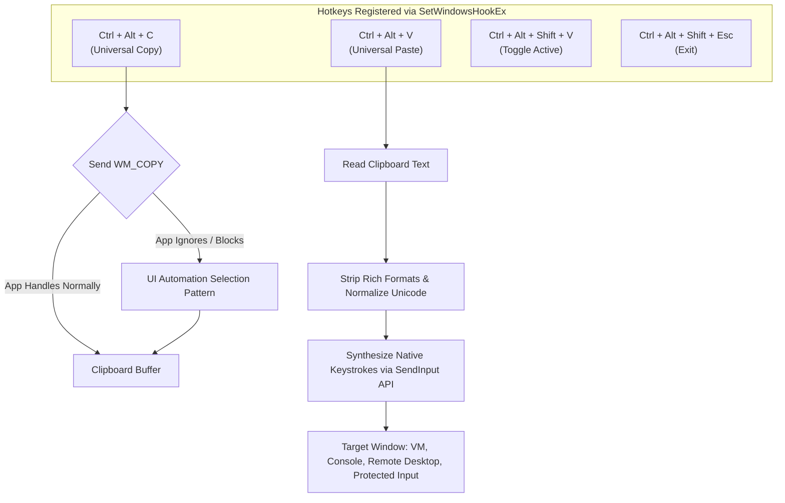

<p align="center"><a href="https://kitsunetechnologies.org/work"></a></p>

# Clipboard Rescue (Universal Copy/Paste)

> Windows hotkeys that copy anything and paste as plain text keystrokes into stubborn terminals, remote sessions, virtual machines, and copy-restricted apps.

<p align="center">
  <a href="https://github.com/KitsuneTech1/universal-copy-paste/releases"></a>
  <a href="https://github.com/KitsuneTech1/universal-copy-paste/actions/workflows/ci.yml"></a>
  <a href="LICENSE"></a>
  <a href="https://learn.microsoft.com/powershell/"></a>
  <a href="https://microsoft.com/windows"></a>
  <a href="https://github.com/KitsuneTech1/universal-copy-paste"></a>
</p>

<p align="center">
  <a href="https://github.com/KitsuneTech1/universal-copy-paste/releases/latest"><strong>📦 Download Latest Release ZIP</strong></a> •
  <a href="#-quick-start-no-setup-required"><strong>⚡ Quick Start Guide</strong></a>
</p>

---

Clipboard Rescue (source repo: `universal-copy-paste`) is a small PowerShell tray utility:
- **`Ctrl+Alt+C`** copies selected text even when an application disables normal copy by falling back to the Windows UI Automation tree.
- **`Ctrl+Alt+V`** types the clipboard as plain-text keystrokes directly into fields, consoles, and remote sessions that block normal paste.
- Your standard **`Ctrl+C` and `Ctrl+V` stay completely untouched**.

---

## Architecture & Keystroke Pipeline



---

## ⚡ What it does

- Runs as a lightweight tray utility on Windows with a single active instance guard.
- Keeps native `Ctrl+C` and `Ctrl+V` unchanged by default.
- Copies selected text with `Ctrl+Alt+C`: sends a copy command to the focused control, then falls back to reading through UI Automation.
- Pastes clipboard text with `Ctrl+Alt+V` by typing Unicode keystrokes as plain text (formatting dropped).
- Toggles utility on/off with `Ctrl+Alt+Shift+V`.
- Cleanly exits with `Ctrl+Alt+Shift+Esc`.
- Runs entirely on your PC. No network calls, no telemetry, 100% private.

---

## 🚀 Quick Start (No Setup Required)

### 1. Download & Launch
1. Download [**Universal Copy/Paste ZIP**](https://github.com/KitsuneTech1/universal-copy-paste/releases/latest) and extract it.
2. Double-click **`start.bat`** (or `Start-UniversalCopyPaste.cmd`).
3. The launcher starts in the background and places an icon in your system tray near the clock.

### 2. Verify with Notepad (10-Second Test)
1. Open Notepad and type a line of text.
2. Select the line and press **`Ctrl+Alt+C`**.
3. Press `End`, then `Enter`, then **`Ctrl+Alt+V`**.
4. The exact same line appears again, typed automatically as native keystrokes.

> **Tip for Admin Windows**: If the target app runs as Administrator, use **`Start-UniversalCopyPaste-Admin.cmd`** so the hook has elevation permissions to deliver keystrokes.

---

## ⚙️ Configuration & Options

### Run at Windows Startup
Double-click `Install-UniversalCopyPaste-Startup.cmd`. It places a shortcut in your user Startup folder (`shell:startup`). Nothing else is modified.

### CLI Switches
Launch from PowerShell with custom switches:

```powershell
powershell.exe -NoProfile -ExecutionPolicy Bypass -STA -File .\UniversalCopyPaste.ps1 -TakeOverCtrlV
```

- `-TakeOverCtrlV`: Makes plain `Ctrl+V` run plain text typing paste.
- `-TakeOverCtrlC`: Makes plain `Ctrl+C` run backup copy.
- `-StartDisabled`: Starts with hotkeys paused (toggle on with `Ctrl+Alt+Shift+V`).
- `-CompileOnly`: Checks C# P/Invoke compilation and exits immediately.

---

## 🧪 Testing

Run the included offline Pester test suite:

```powershell
powershell.exe -NoProfile -Command "Import-Module Pester; Invoke-Pester -Path .\tests -PassThru"
```

The suite validates:
- Presence of release launchers and startup scripts.
- Memory layout of the 32-bit and 64-bit native `INPUT` union for `SendInput`.
- Safe path handling (no path interpolation into PowerShell execution strings).
- User path wiring and hotkey mappings.

---

## 🔧 Troubleshooting

- **`UniversalCopyPaste.ps1 cannot be loaded because running scripts is disabled`**: Launch using `start.bat` or use `-ExecutionPolicy Bypass` as shown in the commands above.
- **Nothing happens when double-clicking `.cmd`**: Right-click the `.cmd` file, select **Properties**, check **Unblock**, and click **OK**.
- **`UniversalCopyPaste only supports Windows`**: Requires Windows 10 or 11 with PowerShell 5.1.
- **`Universal Copy/Paste is already running`**: Only one copy can run at a time. Check the tray icon near the clock or press `Ctrl+Alt+Shift+Esc` to exit.
- **`Could not install the keyboard hook`**: Ensure you start PowerShell normally. If target app is elevated, use `Start-UniversalCopyPaste-Admin.cmd`.
- **Paste does nothing in one app**: Some protected security fields (e.g. anti-cheat, secure credential entry) intentionally block synthetic keystrokes.

---

## 🔒 Security & Privacy Model

- **100% Local**: No network sockets opened, zero outbound traffic.
- **Password Protection**: UI Automation selection patterns honor Windows accessibility bounds and will not expose masked password fields.
- **Safe Hotkeys**: Hotkeys pass through unhandled keys without input latency.

---

## License

MIT. Copyright (c) 2026 Kitsune Technologies LLC. Full text in [LICENSE](LICENSE).

<p align="center"><sub>Part of <b>Buildtober 2026</b>: 31 open source projects in 31 days. Built by <a href="https://kitsunetechnologies.org/work">Kitsune Technologies</a>. More at <a href="https://github.com/KitsuneTech1">github.com/KitsuneTech1</a>.</sub></p>
